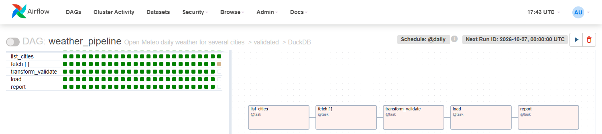

# Multi-City Weather Pipeline (Airflow + DuckDB)


A daily batch pipeline orchestrated with **Apache Airflow**. It pulls weather data for
several cities from the free [Open-Meteo](https://open-meteo.com/) API, validates it, and
loads it idempotently into a **DuckDB** warehouse. Each run then writes a rolling 7-day
report.

```
list_cities ─► fetch[montreal] ─┐
               fetch[toronto]  ─┤
               fetch[vancouver]─┼─► transform_validate ─► load (upsert) ─► report
               fetch[paris]    ─┤
               fetch[casablanca]┘
```



## What it demonstrates

| Concept | How |
|---|---|
| **Dynamic task mapping** | `fetch.expand(city=...)` fans out one task per city in `dags/weather/config.py`. Add a city, get a task. |
| **Idempotency & backfills** | Each run only touches its own day (`ds`): raw files are partitioned by date and the load is an upsert on `(city, date)`. Re-running or backfilling never duplicates data. |
| **Late-arriving data** | Recent days come from the forecast API, older ones from the archive (reanalysis) API. When a day is re-processed later, the archive values replace the forecast. |
| **Data-quality gate** | `transform_validate` fails the run *before* loading if a city is missing, values are null, `temp_min > temp_max`, values fall outside physical ranges, or precipitation is negative. |
| **Medallion-style layout** | `data/raw/date=…/city.json` → `data/clean/date=…/daily_weather.parquet` → `data/weather.duckdb` → `data/reports/` |
| **Testable code** | Logic lives in a plain Python package (`dags/weather/`), unit-tested without Airflow. A separate test checks DAG integrity. |
| **Resilience** | 3 retries with exponential backoff on every task; atomic file writes so a retry never reads a half-written file. |

## Run it

```bash
docker compose up -d
# open http://localhost:8080 (admin / admin) and unpause `weather_pipeline`
```

The DAG starts on 2026-10-01 with `catchup=True`, so unpausing it backfills every day since
then, one run at a time (DuckDB allows a single writer). In testing, 26 days caught up in
about 4 minutes. To re-process a range later, clear it and let the scheduler re-run it.
Thanks to the upsert, nothing is duplicated:

```bash
docker compose exec airflow-scheduler airflow tasks clear weather_pipeline -s 2026-10-01 -e 2026-10-07 -y
```

> Avoid the `airflow dags backfill` CLI with this DAG. In Airflow 2.9 the CLI backfill job
> deadlocks on dynamically mapped tasks after the first run. Scheduler catch-up and
> `tasks clear` are not affected.

Query the warehouse:

```bash
docker compose exec airflow-scheduler python -c "
import duckdb; print(duckdb.connect('/opt/airflow/data/weather.duckdb', read_only=True)
  .sql('SELECT city, COUNT(*) days, ROUND(AVG(temp_max_c),1) avg_max FROM daily_weather GROUP BY city'))"
```

## Project layout

```
dags/
├── weather_pipeline_dag.py   # DAG definition only (TaskFlow API)
└── weather/                  # pipeline logic, no Airflow dependency
    ├── config.py             # cities, paths, API endpoints
    ├── extract.py            # API call, raw landing (atomic write)
    ├── transform.py          # JSON → tidy DataFrame + quality checks
    └── storage.py            # DuckDB upsert + rolling report
tests/
├── test_weather.py           # unit tests (fake HTTP session, temp DuckDB)
└── test_dag.py               # DagBag import + structure
```

## Tests

```bash
pip install -r requirements-dev.txt
pytest            # DAG test is skipped unless Airflow is installed (CI installs it)
```
